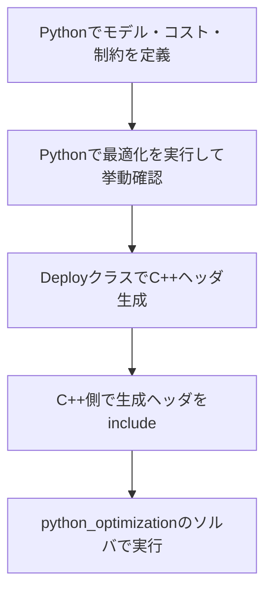

# 全体像と利用フロー

このリポジトリは、Pythonで最適化問題（特にNMPC向け）を定義・検証し、必要に応じてC++向けコードへ展開して実装するための構成になっています。

## 1. 主なフォルダの役割

| フォルダ | 役割 | 主な内容 |
|---|---|---|
| `python_optimization` | C++最適化ソルバ本体 | QP Active Set、SQP Active Set + PCG + PLS、ALM/PANOC など |
| `optimization_utility` | Python→C++コード生成ユーティリティ | `SQP_MatrixUtilityDeploy`、`OptimizationEngine_MatrixUtilityDeploy` |
| `sample` | 利用サンプル | Pythonでの問題定義・生成、C++での実行例 |
| `external_libraries/*` | 依存ライブラリ | 行列演算、数式変換、制御モデル、最適化補助 |

## 2. 典型的な開発フロー

## 3. サンプルで使われる代表パターン

### パターンA: 直接ソルバを使う（C++）

- `sample/qp_active_set_demo_1.cpp`
- `sample/qp_active_set_demo_2.cpp`

固定サイズのQP問題を作って `make_QP_ActiveSetSolver<...>()` で解きます。

### パターンB: PythonでNMPC問題を定義してSQPで解く

- `sample/sqp_pendulum_demo.py`
- `sample/sqp_2_mass_spring_damper_demo.py`

`SQP_CostMatrices_NMPC` を作り、`SQP_ActiveSet_PCG_PLS` へ関数を渡して解きます。
同時に `SQP_MatrixUtilityDeploy.generate_cpp_code(...)` でC++ヘッダを生成できます。

### パターンC: PythonでNMPC問題を定義してALM/PANOCで解く

- `sample/sqp_pendulum_demo_op_en.py`

`OptimizationEngine_CostMatrices` と `ALM_PM_Optimizer` を組み合わせ、`OptimizationEngine_MatrixUtilityDeploy.generate_cpp_code(...)` でC++展開します。

## 4. 外部ライブラリの役割（本リポジトリでの使われ方）

| 外部ライブラリ | 本リポジトリでの主用途 |
|---|---|
| `base_utility_cpp` | 低レイヤのユーティリティ（テンプレート補助、共通基盤） |
| `python_math_to_cpp` | Python数式表現からC++への変換補助 |
| `python_numpy_to_cpp` | 固定サイズ行列型・線形代数・コード生成補助 |
| `MCAP_python_control` | 状態方程式・観測方程式など制御モデルの展開補助 |
| `MCAP_python_optimization` | Python側の最適化問題表現（コスト行列など） |
| `python_control_to_cpp` | 制御関連のPython記述からC++コード化する橋渡し |

> 補足: 外部ライブラリの詳細API説明は元ドキュメントにありますが、本ガイドは本リポジトリ内の利用に必要な範囲へ要約しています。

