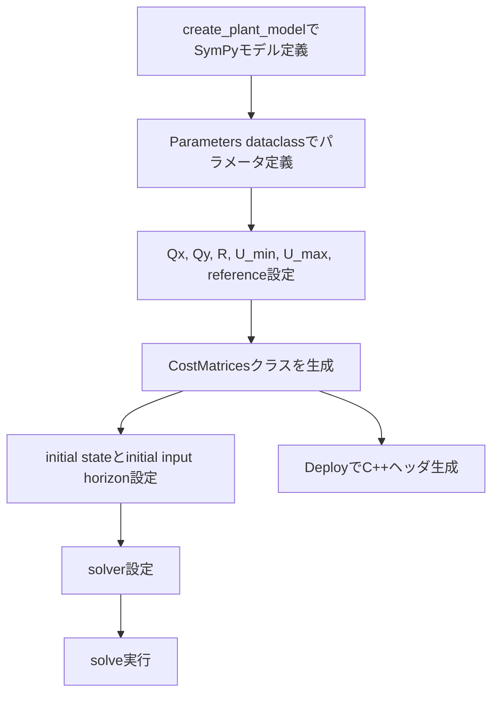

# Pythonサンプル実装ガイド

この章では、`sample` 内のPythonコードがどのように組み立てられているかを、実装手順ベースで説明します。

## 1. 共通構成

`sample/sqp_pendulum_demo.py`、`sample/sqp_2_mass_spring_damper_demo.py`、`sample/sqp_pendulum_demo_op_en.py` は、ほぼ同じ骨格を持ちます。

## 2. SQP系サンプルの使い方

対象:

- `sample/sqp_pendulum_demo.py`
- `sample/sqp_2_mass_spring_damper_demo.py`

### 2.1 問題定義

- `x_syms`, `u_syms`: 状態・入力シンボル
- `state_equation_vector` (`f`)
- `measurement_equation_vector` (`h`)
- `Np`: 予測ホライズン長
- `Qx`, `Qy`, `R`: 重み
- `U_min`, `U_max`: 入力制約

これらを `SQP_CostMatrices_NMPC(...)` に渡します。

### 2.2 実行

`SQP_ActiveSet_PCG_PLS(U_size=(nu, N))` を生成し、`solve(...)` に以下を渡します。

- `U_horizon_initial`
- `cost_and_gradient_function`
- `cost_function`
- `hvp_function`
- `X_initial`
- `U_min_matrix`, `U_max_matrix`

## 3. Optimization Engine (ALM/PANOC) 系サンプルの使い方

対象:

- `sample/sqp_pendulum_demo_op_en.py`

### 3.1 問題定義

`OptimizationEngine_CostMatrices(...)` を作成し、`X_initial`・`reference_trajectory` を設定します。

### 3.2 ALM/PANOCの構築

主な構成要素:

- `ALM_Factory`: コスト、勾配、制約写像、Jacobian転置を登録
- `ALM_Problem`: 境界条件・写像・射影を束ねる
- `PANOC_Cache`, `ALM_Cache`: 反復用キャッシュ
- `ALM_PM_Optimizer`: 最終ソルバ本体

## 4. Python側コード生成API

| 用途 | API |
|---|---|
| SQP向けコスト行列をC++化 | `SQP_MatrixUtilityDeploy.generate_cpp_code(cost_matrices=...)` |
| ALM/PANOC向けコスト行列をC++化 | `OptimizationEngine_MatrixUtilityDeploy.generate_cpp_code(cost_matrices=...)` |

`generate_cpp_code` の戻り値は、生成されたヘッダファイル名リストです（サンプルでは `print(deployed_file_names)` で確認）。

## 5. 実装時の最小チェックポイント

1. `Parameters` dataclass の値がモデル式と整合しているか
2. `reference_trajectory` のサイズが `Np + 1` と一致しているか
3. `U_horizon_initial` の形状がソルバ想定と一致しているか
4. `U_min/U_max` の形状が `nu x 1` になっているか
5. C++生成が必要なら `generate_cpp_code` を `solve` 前後で呼び出す

