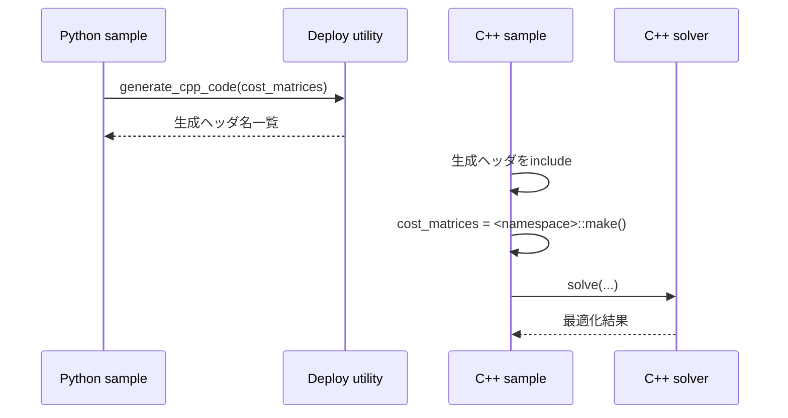

# C++サンプル実装ガイドとPython/C++インターフェース対応

この章では、`sample` 内のC++コードをもとに、Pythonで定義した問題とC++実行側インターフェースの対応関係を説明します。

## 1. C++サンプルの分類

| サンプル | 目的 | 使用ソルバ |
|---|---|---|
| `sample/qp_active_set_demo_1.cpp` | 小規模QPを直接解く | `QP_ActiveSetSolver` |
| `sample/qp_active_set_demo_2.cpp` | パラメータ調整付きQP | `QP_ActiveSetSolver` |
| `sample/sqp_pendulum_demo.cpp` | 生成済みSQPコストでNMPC | `SQP_ActiveSet_PCG_PLS` |
| `sample/sqp_2_mass_spring_damper_demo.cpp` | 2質点系NMPC | `SQP_ActiveSet_PCG_PLS` |
| `sample/sqp_pendulum_demo_op_en.cpp` | 生成済みコストでALM/PANOC | `ALM_PM_Optimizer` |

## 2. `python_optimization.hpp` の利用方針

各サンプルは次の形で統一されています。

```cpp
#include "python_numpy.hpp"
#include "python_optimization.hpp"
```

`python_optimization.hpp` は、主に以下の公開要素をまとめて取り込みます。

- QP Active Set
- SQP Active Set + PCG + PLS
- PANOC / ALM-PM Optimizer
- 共通の関数オブジェクト型（cost, gradient, hvp）

## 3. PythonクラスとC++クラスの対応

| Python側（sampleで使用） | C++側（sampleで使用） | 使い方の要点 |
|---|---|---|
| `SQP_CostMatrices_NMPC` | 生成ヘッダ内 `namespace ... { using type = SQP_CostMatrices_NMPC_Type<...>; }` | `auto cost_matrices = <namespace>::make();` で生成 |
| `SQP_ActiveSet_PCG_PLS` | `make_SQP_ActiveSet_PCG_PLS<Cost_Matrices_Type>()` | `solve(U0, cost_grad, cost, hvp, X0, Umin, Umax)` |
| `OptimizationEngine_CostMatrices` | 生成ヘッダ内 `using type = OptimizationEngine_CostMatrices_Type<...>;` | `cost_matrices.compute_cost/compute_gradient/...` をALMへ接続 |
| `ALM_PM_Optimizer` | `make_ALM_PM_Optimizer<Cost_Matrices_Type, N1, N2>()` | `set_problem(...)` 後に `solve(U0)` |
| `QP_ActiveSetSolver` | `make_QP_ActiveSetSolver<T, n_var, n_constr>()` | `solve(E, L, M, Gamma)` |

## 4. SQPサンプル（C++）の実装手順

`sample/sqp_pendulum_demo.cpp` と `sample/sqp_2_mass_spring_damper_demo.cpp` は、次の順序で構成されています。

1. 生成済みヘッダを `#include`
2. `auto cost_matrices = <generated_namespace>::make();`
3. 型エイリアスを取り出し (`X_Type`, `U_horizon_Type` など)
4. ラムダで `cost_function`, `cost_and_gradient_function`, `hvp_function` を接続
5. `make_SQP_ActiveSet_PCG_PLS<Cost_Matrices_Type>()` でソルバ生成
6. `set_solver_max_iteration(...)`
7. `solve(...)`

## 5. ALM/PANOCサンプル（C++）の実装手順

`sample/sqp_pendulum_demo_op_en.cpp` は、SQPサンプルより設定項目が多くなります。

1. 生成済み最適化エンジンヘッダを `#include`
2. `ALM_Factory_Type` に cost/gradient/mapping/Jacobian転置を登録
3. `ALM_Problem_Type` に制約・境界・射影を登録
4. `make_ALM_PM_Optimizer<...>()`
5. `set_problem(problem)` と `set_solver_max_iteration(outer, inner)`
6. `solve(U_horizon_initial)` と `get_solver_status()`

## 6. QPサンプル（C++）の実装手順

`sample/qp_active_set_demo_1.cpp` / `sample/qp_active_set_demo_2.cpp` では、問題を行列で直接定義します。

- `E`: 二次項
- `L`: 線形項
- `M`: 制約行列
- `Gamma`: 制約上限

必要に応じて `set_max_iteration`, `set_tol`, `set_kkt_inv_solver_division_min` を設定してから `solve(E, L, M, Gamma)` を呼びます。

## 7. Python→C++呼び出し対応フロー



