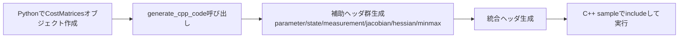

# コード生成機能ガイド（Deploy）

この章では、`optimization_utility` のDeploy機能を使って、Pythonで定義した問題をC++ヘッダへ展開する方法を説明します。

## 1. 生成APIの使い分け

| API | 対象 | 生成される主な要素 |
|---|---|---|
| `SQP_MatrixUtilityDeploy.generate_cpp_code(...)` | SQP向け (`SQP_CostMatrices_NMPC`) | 状態/観測式、Jacobian、Hessian、制約上下限、統合コスト行列クラス |
| `OptimizationEngine_MatrixUtilityDeploy.generate_cpp_code(...)` | ALM/PANOC向け (`OptimizationEngine_CostMatrices`) | 状態/観測式、Jacobian、制約上下限、統合コスト行列クラス |

> ALM/PANOC向けでは、1次情報中心のためHessian生成は行わない構成です。

## 2. 生成コードの命名規則

Deployでは、呼び出し元ファイル名と `cost_matrices` 変数名を使って、統合ヘッダ名（namespace名）を決定します。

- 例: `sample/sqp_pendulum_demo.py` で `sqp_cost_matrices` を渡す
  → `sqp_pendulum_demo_sqp_cost_matrices.hpp`
- 例: `sample/sqp_pendulum_demo_op_en.py` で `oe_cost_matrices` を渡す
  → `sqp_pendulum_demo_op_en_oe_cost_matrices.hpp`

この命名は、対応するC++サンプルの `#include` 名と一致します。

## 3. 生成ヘッダのインターフェース（共通）

生成される統合ヘッダには、概ね次の公開要素が含まれます。

- `constexpr` 定数（`NP`, `INPUT_SIZE`, `STATE_SIZE`, `OUTPUT_SIZE`）
- 型定義（`X_Type`, `U_Type`, `Y_Type`, `Reference_Trajectory_Type` など）
- `using type = ...`（コスト行列クラス本体）
- `inline auto make() -> type`

つまりC++側では、次の1行で利用開始できます。

```cpp
auto cost_matrices = <generated_namespace>::make();
```

## 4. 生成フローの実務上の見方



## 5. 最小サンプル（Python側）

### SQP向け

```python
deployed_file_names = SQP_MatrixUtilityDeploy.generate_cpp_code(
    cost_matrices=sqp_cost_matrices
)
print(deployed_file_names)
```

### ALM/PANOC向け

```python
deployed_file_names = OptimizationEngine_MatrixUtilityDeploy.generate_cpp_code(
    cost_matrices=oe_cost_matrices
)
print(deployed_file_names)
```

## 6. C++側接続ポイント

| 接続先 | 具体例 |
|---|---|
| SQP | `make_SQP_ActiveSet_PCG_PLS<Cost_Matrices_Type>()` |
| ALM/PANOC | `make_ALM_PM_Optimizer<Cost_Matrices_Type, N1, N2>()` |
| 直接QP | `make_QP_ActiveSetSolver<T, NV, NC>()`（生成ヘッダ不要） |

## 7. よくある実装ミス

1. Python側でモデル更新後に `generate_cpp_code` を再実行せず、古いヘッダを使う
2. `U_min/U_max` や `Y_min/Y_max` の形状不整合
3. C++側で `Cost_Matrices_Type` や `N1` の次元を取り違える
4. 生成ヘッダのnamespace名（=ファイル名ベース）を誤る

